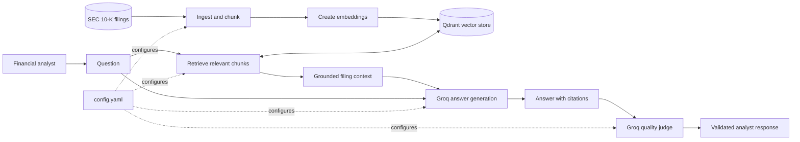

# FinRAG

**FinRAG** is a retrieval-augmented generation (RAG) system for answering financial-analysis questions from public companies' annual reports. It is designed to ground every answer in SEC 10-K filings, cite the source of each factual claim, and state when the available filings do not contain the answer.

> **Project status:** v0.1.0 early development. SEC EDGAR filing acquisition and 10-K parsing (steps 1.3–1.4) are implemented. Chunking, indexing, retrieval, answer generation, and evaluation remain planned and are not yet implemented.

## What it is for

FinRAG is built for financial analysts who need answers from a bounded filing corpus rather than general web knowledge. The initial corpus covers FY2021 and FY2022 10-K filings for 15 public companies (30 filings total), sourced from SEC EDGAR:

AMD, Boeing, American Express, PepsiCo, 3M, Verizon, CVS Health, AES, Johnson & Johnson, Corning, Lockheed Martin, Coca-Cola, American Water Works, General Mills, and Pfizer.

The v1 scope excludes 10-Qs, earnings calls, real-time prices, and investment advice.

## Design principles

- **Grounded answers:** answer only from retrieved filing context.
- **Traceable claims:** cite facts as `[company, year, section]`.
- **Numerical integrity:** use figures from the correct company and fiscal year; calculations should show their inputs.
- **Explicit uncertainty:** return `Not found in the filings.` instead of guessing when evidence is unavailable.
- **Operational discipline:** target p95 query latency below 10 seconds and track cost per query.

## Intended architecture

| Layer | v1 technology | Configuration |
| --- | --- | --- |
| Corpus | SEC EDGAR 10-K filings | `data/manifest.csv` |
| Chunking | Fixed-size chunks (512 tokens, 64-token overlap) | `config.yaml` |
| Embeddings | Local `BAAI/bge-small-en-v1.5` | `config.yaml` |
| Vector search | Local Qdrant | `config.yaml` |
| Answer generation | Groq `openai/gpt-oss-120b` | `config.yaml` |
| Answer evaluation | Groq `openai/gpt-oss-20b` | `config.yaml` |

The answer prompt at [`prompts/answer_v1.md`](prompts/answer_v1.md) enforces source citations and the required no-evidence response.



The diagram represents the proposed v1 flow. Components under `src/finrag` are organized around these responsibilities as implementation proceeds.

## Getting started

### Prerequisites

- Python 3.12 or later
- A [Groq API key](https://console.groq.com/keys)
- An SEC-compliant User-Agent containing your name and email address

### Install

```bash
git clone https://github.com/Day-Raval/finrag.git
cd finrag
python -m venv .venv
source .venv/bin/activate
python -m pip install --upgrade pip
python -m pip install -r requirements.txt
```

### Configure credentials

```bash
cp .env.example .env
```

Set the following values in `.env`:

```dotenv
GROQ_API_KEY=your_groq_api_key
SEC_USER_AGENT="Your Name your.email@example.com"
```

`.env` is ignored by Git. Never commit API keys or personal contact details.

### Validate the local setup

```bash
pytest
```

The tests cover configuration and environment setup, plus the filing fetcher and parser. The fetcher/parser tests run offline and do not contact SEC EDGAR.

### Fetch and parse SEC filings

With `SEC_USER_AGENT` set in `.env`, run these commands from the repository root:

```bash
python -m finrag.ingestion.fetch_filings
python -m finrag.ingestion.parse_filings
```

The fetcher retrieves the configured FY2021 and FY2022 10-Ks for 15 companies (30 filings), skips amendments, respects SEC request limits, and writes filing metadata and SHA-256 checksums to `data/manifest.csv`. Fiscal years are based on the filing period end, with first-week-of-January ends assigned to the prior fiscal year for 52/53-week companies. Existing raw filings are skipped on reruns.

The parser writes one JSONL record per 10-K Item under `data/parsed/`, preserving section metadata and formatting tables as Markdown. Its report flags filings that need review before downstream processing. All generated files under `data/` are gitignored; see [`src/finrag/ingestion/README.md`](src/finrag/ingestion/README.md) for parsing details, output fields, and known filing quirks.

## Repository layout

```text
.
├── config.yaml              # RAG, model, and chunking configuration
├── prompts/
│   └── answer_v1.md         # Grounded-answer prompt contract
├── src/finrag/
│   ├── ingestion/           # Implemented EDGAR fetcher and 10-K parser
│   ├── indexing/            # Planned embeddings and Qdrant indexing
│   ├── answering/           # Planned retrieval and grounded answer generation
│   ├── evaluation/          # Planned answer quality checks
│   └── __init__.py          # Application package
├── tests/
│   ├── test_fetch_filings.py
│   ├── test_parse_filings.py
│   └── test_smoke.py        # Configuration and environment checks
├── .env.example             # Required environment-variable template
└── spec.md                  # Product scope and quality bar
```

## Configuration

Runtime behavior is centralized in [`config.yaml`](config.yaml):

- `corpus`: filing years and manifest location
- `chunking`: chunk strategy, size, and overlap
- `embedding`: embedding provider and model
- `retrieval`: result count and retrieval enhancements
- `generation` and `judge`: Groq models and decoding settings

Keep model and retrieval changes in this file so experiments remain reviewable and reproducible.

## Quality contract

An answer is considered acceptable only when it:

1. Uses the correct company and fiscal year, with values accurate to within ±1% after rounding.
2. Cites every factual claim with the company, year, and 10-K section.
3. Shows inputs for derived calculations.
4. Does not fabricate evidence when the corpus has no supporting passage.

See [`spec.md`](spec.md) for the full v1 requirements.

## Development

Run the test suite before submitting changes:

```bash
pytest
```

Dependencies are listed in [`requirements.txt`](requirements.txt). The project currently uses a `src/` package layout and requires Python 3.12+.

### Package boundaries

The source package is separated by pipeline stage:

| Package | Responsibility |
| --- | --- |
| `finrag.ingestion` | Download, parse, normalize, and chunk SEC filings. |
| `finrag.indexing` | Create chunk embeddings and maintain the Qdrant index. |
| `finrag.answering` | Retrieve evidence, assemble prompts, and generate cited answers. |
| `finrag.evaluation` | Judge answer quality against the retrieval and citation contract. |

## Security and data handling

- Treat `.env` as sensitive and keep it local.
- Use a truthful, contactable SEC User-Agent when downloading filings.
- Keep source filings and manifests reproducible; do not present retrieved content as real-time market data.
- FinRAG is an analytical research tool, not investment advice.

## License

No license has been specified yet. Do not assume permission to reuse or redistribute the project until a license is added.
