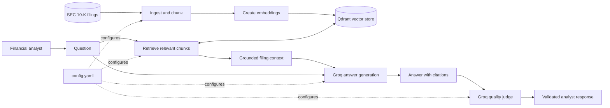

# Annualyst

*Grounded Q&A over SEC 10-K filings, with an evaluation harness. Repository and Python package: `finrag`. Latest release: [v0.1.0](https://github.com/Day-Raval/finrag/releases/tag/v0.1.0).*

**Annualyst** is a retrieval-augmented generation (RAG) system for answering financial-analysis questions from public companies' annual reports. It is designed to ground every answer in SEC 10-K filings, cite the source of each factual claim, and state when the available filings do not contain the answer.

> **Project status:** v0.1.0 baseline RAG is implemented, evaluated, and released. The pipeline parses SEC filings, creates fixed-size chunks, embeds and indexes them locally, retrieves the top five matching chunks, and generates grounded answers with Groq. A 79-question golden set, deterministic scoring, and an LLM judge validated against hand labels measure the baseline. Since v0.1.0 the repository also has experiment tooling: a 24-question dev subset, an LLM response cache, and a run-to-run diff. The baseline's results expose substantial answer-quality and false-refusal gaps; it is not production-ready.

## What it is for

Annualyst is built for financial analysts who need answers from a bounded filing corpus rather than general web knowledge. The initial corpus covers FY2021 and FY2022 10-K filings for 15 public companies (30 filings total), sourced from SEC EDGAR:

AMD, Boeing, American Express, PepsiCo, 3M, Verizon, CVS Health, AES, Johnson & Johnson, Corning, Lockheed Martin, Coca-Cola, American Water Works, General Mills, and Pfizer.

The v1 scope excludes 10-Qs, earnings calls, real-time prices, and investment advice.

## Design principles

- **Grounded answers:** answer only from retrieved filing context.
- **Traceable claims:** cite facts as `[company, year, section]`.
- **Numerical integrity:** use figures from the correct company and fiscal year; calculations should show their inputs.
- **Explicit uncertainty:** return `Not found in the filings.` instead of guessing when evidence is unavailable.
- **Operational discipline:** target p95 query latency below 10 seconds and track cost per query.

## Intended architecture

| Layer | v1 technology | Configuration |
| --- | --- | --- |
| Corpus | SEC EDGAR 10-K filings | `data/manifest.csv` |
| Chunking | Fixed-size chunks (512 tokens, 64-token overlap) | `config.yaml` |
| Embeddings | Local `BAAI/bge-small-en-v1.5` | `config.yaml` |
| Vector search | Local Qdrant | `config.yaml` |
| Answer generation | Groq `openai/gpt-oss-120b` | `config.yaml` |
| Answer evaluation | Deterministic scorers and Groq `openai/gpt-oss-20b` judge | `config.yaml` |

The answer prompt at [`prompts/answer_v1.md`](prompts/answer_v1.md) enforces source citations and the required no-evidence response.



The implemented baseline follows the complete flow, including deterministic scoring and the Groq quality judge. Components under `src/finrag` are organized around these pipeline responsibilities.

## Getting started

### Prerequisites

- Python 3.12 or later
- A [Groq API key](https://console.groq.com/keys)
- An SEC-compliant User-Agent containing your name and email address

### Install

```bash
git clone https://github.com/Day-Raval/finrag.git
cd finrag
python -m venv .venv
source .venv/bin/activate
python -m pip install --upgrade pip
python -m pip install -r requirements.txt
```

### Configure credentials

```bash
cp .env.example .env
```

Set the following values in `.env`:

```dotenv
GROQ_API_KEY=your_groq_api_key
SEC_USER_AGENT="Your Name your.email@example.com"
```

`.env` is ignored by Git. Never commit API keys or personal contact details.

### Validate the local setup

```bash
pytest
```

The tests cover configuration and environment setup, filing fetching and parsing, fixed-size chunking, deterministic scoring, judge-output parsing, judge-agreement statistics, the dev subset, the LLM response cache, run comparison, citation-context formatting, and golden-set construction. All tests run offline: they do not contact SEC EDGAR or Groq.

### Build the local RAG corpus

With `SEC_USER_AGENT` set in `.env`, run these commands from the repository root:

```bash
python -m finrag.ingestion.fetch_filings
python -m finrag.ingestion.parse_filings
python -m finrag.indexing.build_index
```

The fetcher retrieves the configured FY2021 and FY2022 10-Ks for 15 companies (30 filings), skips amendments, respects SEC request limits, and writes filing metadata and SHA-256 checksums to `data/manifest.csv`. Fiscal years are based on the filing period end, with first-week-of-January ends assigned to the prior fiscal year for 52/53-week companies. Existing raw filings are skipped on reruns.

The parser writes one JSONL record per 10-K Item under `data/parsed/`, including a `COVER` section for cover-page facts, preserving section metadata and formatting tables as Markdown. Its report flags filings that need review before downstream processing. The index builder tokenizes each parsed section into overlapping 512-token chunks, embeds them with `BAAI/bge-small-en-v1.5`, writes the chunks to `data/index/chunks.jsonl`, and rebuilds the local Qdrant collection. All generated files under `data/` are gitignored; see [`src/finrag/ingestion/README.md`](src/finrag/ingestion/README.md) for parsing details, output fields, and known filing quirks.

### Ask a question

After building the index, query the baseline pipeline with a Groq API key configured:

```bash
python -m finrag.answering.pipeline "What was 3M's FY2022 revenue?"
```

The command retrieves the top five dense matches from the local Qdrant index, sends their citation-labeled text to the configured Groq model, and prints the answer, retrieved chunk IDs and scores, latency, and token usage.

### Create and run the golden set

Build the golden set after parsing filings:

```bash
python -m finrag.evaluation.build_golden
```

This downloads and caches FinanceBench's open sample in `data/financebench/`, selects in-scope 10-K questions, maps their evidence to parsed filing sections, and combines them with the project's custom cases. The resulting `evals/golden.jsonl` contains 57 FinanceBench and 22 custom questions across extraction, numeric, reasoning, open, comparison, multi-year, and unanswerable categories.

To run every golden question through the current pipeline:

```bash
python -m finrag.answering.run_golden baseline
```

Results and a copy of the active configuration are written to `reports/runs/baseline/`. Interrupted or rate-limited runs are resumable: rerun the same command to skip completed questions.

Score the saved answers and run the judge:

```bash
python -m finrag.evaluation.score_run baseline
python -m finrag.evaluation.retrieval_eval dense_fixed_512_64
python -m finrag.evaluation.judge baseline correctness
python -m finrag.evaluation.judge baseline faithfulness
```

`score_run` writes per-question scores and `summary.json`; `retrieval_eval` writes retrieval-only metrics without generating answers. The judge writes one JSONL result per mode, skips completed verdicts, and retries invalid prior verdicts. Correctness compares an answer with its reference; faithfulness checks non-refused answers against their retrieved context.

### Validate the judge

Before trusting judge scores, compare them with your own labels on a fixed sample of 20 answers (16 attempted answers and 4 refusals):

```bash
python -m finrag.evaluation.label baseline       # interactive; the judge's verdicts are hidden
python -m finrag.evaluation.agreement baseline   # agreement, Cohen's kappa, disagreements
```

Labels are saved to `reports/runs/<run>/human_labels.jsonl` after every answer, so labelling can be stopped and resumed. The target is at least 80% pass/fail agreement and kappa of at least 0.6.

### Run experiments cheaply

Groq's free tier allows about 200K tokens per model per day, and a full 79-question run uses about 240K. Day-to-day experiments therefore use a fixed 24-question dev subset (3–4 questions per category, about 72K tokens), and the full golden set is kept for milestone runs:

```bash
python -m finrag.evaluation.make_dev                 # writes evals/dev.jsonl (fixed seed)
python -m finrag.answering.run_golden my_exp dev     # answer the dev subset
python -m finrag.evaluation.score_run my_exp
python -m finrag.evaluation.judge my_exp correctness
python -m finrag.evaluation.diff dev_baseline my_exp # what improved, what regressed
```

Every Groq call (answers and judge verdicts) is cached under `data/cache/llm/`, keyed by model, full prompt, and decoding settings. Rerunning an unchanged configuration therefore costs no tokens, and an experiment only pays for questions whose prompt actually changed. Empty answers and unparseable judge replies are never cached. `diff` compares only the questions both runs answered and exits with code 1 if judged correctness drops by more than 0.05, so it can gate CI. Retrieval-only experiments need no LLM at all: use `retrieval_eval`.

## Baseline results

The checked-in `baseline` run answered all 79 golden questions. Its retrieval-only results for fixed 512-token chunks, 64-token overlap, and top-5 dense search were:

| Metric | Result |
| --- | ---: |
| Section recall | 54.3% |
| Document recall | 85.5% |
| MRR | 0.329 |

For the 69 answerable questions, deterministic scoring found a 17.2% numeric-match rate, 29.0% citation rate, and 68.1% false-refusal rate. The 10 unanswerable cases were refused correctly. Median latency was 22.8 seconds and p95 was 32.01 seconds, which is above the project target.

The LLM judge marked 20 answers correct, 3 partial, and 56 incorrect (0.272 weighted correctness). Of 22 non-refused answers evaluated for faithfulness, 20 were faithful and 2 unfaithful (0.909). These baseline measurements identify retrieval coverage, answer completeness, and refusal behavior as the next improvement areas rather than claims of system quality. The 0.272 correctness figure covers all 79 questions; on the 69 answerable ones it is 0.167. The correctness judge was validated against 20 hand-labelled answers: 90% pass/fail agreement, Cohen's kappa 0.74. Both disagreements were the judge being more lenient than the human label, so correctness may be slightly overstated.

On the 24-question dev subset, the checked-in `dev_baseline` run scored 0.214 judged correctness and a 0.619 false-refusal rate on the 21 answerable questions. Comparing it with the original baseline answers to the same questions showed that fresh answers changed in only one place (one answer dropped its citation), so on the dev subset a change of about 0.05 (one question) is within run-to-run noise.

See [CHANGELOG.md](CHANGELOG.md) for the failure breakdown and known limitations.

## Repository layout

```text
.
├── config.yaml              # RAG, model, chunking, golden-set, and index configuration
├── prompts/
│   ├── answer_v1.md              # Grounded-answer prompt contract
│   ├── judge_correctness_v1.md   # Correctness judge rubric
│   └── judge_faithfulness_v1.md  # Faithfulness judge rubric
├── src/
│   ├── README.md            # Source layout note
│   └── finrag/
│       ├── ingestion/
│       │   ├── fetch_filings.py  # EDGAR 10-K downloader
│       │   └── parse_filings.py  # Section-level JSONL parser
│       ├── corpus/
│       │   └── fixed_chunks.py   # Overlapping token chunker
│       ├── embeddings/
│       │   └── encoder.py        # Shared local embedding model
│       ├── indexing/
│       │   └── build_index.py    # Local Qdrant index builder
│       ├── retrieval/
│       │   └── dense.py          # Dense Qdrant retrieval
│       ├── generation/
│       │   ├── answer.py         # Grounded Groq answer generation
│       │   └── cache.py          # Disk cache for LLM calls
│       ├── answering/
│       │   ├── pipeline.py       # Single-question RAG pipeline
│       │   └── run_golden.py     # Resumable golden/dev-set runner
│       ├── evaluation/
│       │   ├── build_golden.py   # FinanceBench/custom golden-set builder
│       │   ├── make_dev.py       # 24-question dev subset
│       │   ├── lookup.py         # Parsed-filing lookup CLI
│       │   ├── scorers.py        # Deterministic scorers
│       │   ├── score_run.py      # Deterministic saved-run scoring
│       │   ├── retrieval_eval.py # Retrieval-only benchmarking
│       │   ├── judge.py          # Correctness and faithfulness judge
│       │   ├── label.py          # Blind hand-labelling CLI
│       │   ├── agreement.py      # Judge-vs-human agreement and kappa
│       │   └── diff.py           # Run-to-run comparison and CI gate
│       └── __init__.py      # Application package
├── evals/
│   ├── custom.jsonl         # Hand-written golden cases
│   ├── golden.jsonl         # Generated FinanceBench and custom cases
│   └── dev.jsonl            # 24-question dev subset
├── reports/
│   ├── runs/                # Per-run answers, scores, judge verdicts, hand labels, config
│   └── retrieval/           # Retrieval-only results
├── tests/                   # Offline tests (no SEC or Groq calls)
├── .env.example             # Required environment-variable template
├── CHANGELOG.md             # Release notes
├── LICENSE                  # MIT
└── spec.md                  # Product scope and quality bar
```

## Configuration

Runtime behavior is centralized in [`config.yaml`](config.yaml):

- `corpus`: filing years and manifest location
- `chunking`: chunk strategy, size, and overlap
- `embedding`: embedding provider and model
- `retrieval`: result count and retrieval enhancements
- `generation` and `judge`: Groq models and decoding settings
- `golden`: golden-set, custom-case, dev-subset, and FinanceBench cache locations
- `index`: local chunk export and Qdrant collection settings
- `runs_dir`: benchmark-output directory

Keep model and retrieval changes in this file so experiments remain reviewable and reproducible.

## Quality contract

An answer is considered acceptable only when it:

1. Uses the correct company and fiscal year, with values accurate to within ±1% after rounding.
2. Cites every factual claim with the company, year, and 10-K section.
3. Shows inputs for derived calculations.
4. Does not fabricate evidence when the corpus has no supporting passage.

See [`spec.md`](spec.md) for the full v1 requirements.

## Development

Run the test suite before submitting changes:

```bash
pytest
```

Dependencies are listed in [`requirements.txt`](requirements.txt). The project currently uses a `src/` package layout and requires Python 3.12+.

### Package boundaries

The source package is separated by pipeline stage:

| Package | Responsibility |
| --- | --- |
| `finrag.ingestion` | Download and parse SEC filings into section-level JSONL. |
| `finrag.corpus` | Create overlapping fixed-token chunks while preserving citation metadata. |
| `finrag.embeddings` | Load and use the shared embedding model for chunks and questions. |
| `finrag.indexing` | Embed chunks and rebuild the local Qdrant collection. |
| `finrag.retrieval` | Return the highest-scoring dense matches from the index. |
| `finrag.generation` | Format cited context, call the Groq answer model, and cache LLM responses. |
| `finrag.answering` | Orchestrate a question, the golden set, or the dev subset through retrieval and generation. |
| `finrag.evaluation` | Build the golden and dev sets, score and compare runs, benchmark retrieval, judge answers, and validate the judge against hand labels. |

## Security and data handling

- Treat `.env` as sensitive and keep it local.
- Use a truthful, contactable SEC User-Agent when downloading filings.
- Keep source filings and manifests reproducible; do not present retrieved content as real-time market data.
- Annualyst is an analytical research tool, not investment advice.

## License

Code is released under the [MIT License](LICENSE).

The 57 FinanceBench questions in `evals/golden.jsonl` (ids starting `fb_`) come from
[FinanceBench](https://huggingface.co/datasets/PatronusAI/financebench) by Patronus AI
(Islam et al., 2023, arXiv:2311.11944) and remain under
[CC BY-NC 4.0](https://creativecommons.org/licenses/by-nc/4.0/): non-commercial use
with attribution. SEC filings are public documents and are not redistributed here;
`fetch_filings` downloads them from EDGAR.